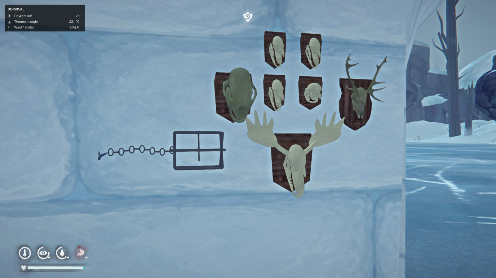

# Burebista Animal Trophies

**v0.4.3 · The Long Dark · Español / English**

[Descargar / Download](https://github.com/florynstefanache-source/BurebistaAnimalTrophies/releases/latest) · [English](#english)

Captura de la partida de Burebista. La trampa visible pertenece al mod de castores y no está incluida en este mod. / Screenshot from Burebista's game. The visible trap belongs to the beaver mod and is not included here.

## Español

Convierte cráneos de **lobo, puma, oso, ciervo y alce** en trofeos con placas de madera. Decora paredes, incluido tu iglú, o ajusta libremente su posición. Los trofeos colocados conservan su posición al guardar y cargar.

### Conseguir cráneos

Cada cadáver compatible tiene una oportunidad del **50 %** de entregar un cráneo después de completar la primera tarea de despiece o descuartizado. Se realiza una sola tirada por cadáver, incluso al guardar y cargar. Cancelar la tarea no entrega el cráneo. Los cráneos sin preparar se añaden a la mochila y no necesitan curado.

### Fabricar trofeos

En un banco de trabajo con luz y herramientas simples o de calidad:

- 1 cráneo sin preparar de la especie correspondiente.
- 1 madera recuperada.
- 1 tripa curada.

| Trofeo | Tiempo |
| --- | --- |
| Lobo | 90 minutos |
| Puma | 90 minutos |
| Oso | 120 minutos |
| Ciervo | 150 minutos |
| Alce | 180 minutos |

### Colocación y controles

Puedes soltar un trofeo terminado y moverlo con la colocación normal del juego; al apuntar a una pared, la placa se orienta sobre ella. También puedes usar el menú de colocación libre:

| Control | Acción |
| --- | --- |
| Ctrl + Alt + F11 | Abrir / cerrar menú |
| 1 / 2 / 3 / 4 / 5 | Elegir lobo / puma / oso / ciervo / alce |
| Flecha arriba / abajo | Alejar / acercar la vista previa |
| Flecha izquierda / derecha | Girar la placa |
| Enter | Fijar el trofeo |
| Esc | Cancelar / cerrar |
| 6 dentro del menú | Recoger el trofeo al que apuntas |

Necesitas el trofeo preparado en la mochila. La colocación libre permite ajustar la distancia entre 0,15 y 8 metros. Recoge los trofeos antes de desmontar un refugio: no se recogen automáticamente con él. La ayuda compartida F9 se integra con BurebistaFishingShelter cuando está instalado.

### Instalación

1. Instala **MelonLoader y ModData**. Cierra el juego.
2. Descarga `BurebistaAnimalTrophies-v0.4.3-ES-EN.zip` desde Releases.
3. Copia `Mods/BurebistaAnimalTrophies.dll` a la carpeta `Mods` de The Long Dark.
4. Sustituye la versión anterior y guarda las copias de seguridad fuera de `Mods`; debe quedar una sola DLL de este mod.
5. Inicia el juego. Los nombres, recetas, descripciones, menú y mensajes siguen el idioma seleccionado: español o inglés.

No necesita `BurebistaLanguages.dll`. El ZIP de código fuente generado por GitHub no es el paquete de instalación.

## English

Turn **wolf, cougar, bear, deer and moose** skulls into trophies mounted on wooden plaques. Decorate walls, including your igloo, or freely adjust their placement. Mounted positions persist when saving and loading.

### Obtaining skulls

Each supported carcass has a **50% chance** to yield a skull after its first completed harvesting or quartering task. Only one roll is made per carcass, including across saves and loads. Cancelling does not yield a skull. Raw skulls go into your inventory and do not need curing.

### Crafting

At a workbench with light and simple or quality tools, use **1 matching raw skull, 1 reclaimed wood and 1 cured gut**. Crafting takes 90 minutes for wolf/cougar, 120 for bear, 150 for deer and 180 for moose.

### Placement and controls

Drop a finished trophy and move it using the game's normal placement mode; pointing at a wall aligns its plaque with that surface. The free-placement menu offers an alternative:

| Control | Action |
| --- | --- |
| Ctrl + Alt + F11 | Open / close trophy menu |
| 1 / 2 / 3 / 4 / 5 | Select wolf / cougar / bear / deer / moose |
| Up / Down arrows | Move preview farther / closer |
| Left / Right arrows | Rotate plaque |
| Enter | Confirm placement |
| Esc | Cancel / close |
| 6 inside the menu | Retrieve the trophy you are pointing at |

You must carry a finished trophy. Free-placement distance ranges from 0.15 to 8 metres. Retrieve trophies before packing a shelter; they are not automatically packed with it. Shared F9 hints integrate with BurebistaFishingShelter when installed.

### Installation

1. Install **MelonLoader and ModData**, then close the game.
2. Download `BurebistaAnimalTrophies-v0.4.3-ES-EN.zip` from Releases.
3. Copy `Mods/BurebistaAnimalTrophies.dll` into The Long Dark's `Mods` folder.
4. Replace the previous version and keep backups outside `Mods`; keep only one copy of this mod's DLL there.
5. Launch the game. Names, recipes, descriptions, menu and messages follow the selected game language: Spanish or English.

`BurebistaLanguages.dll` is not required. GitHub's automatic source ZIP is not the installation package.

## Versión / Version 0.4.3

Traducción español/inglés conservando modelos, recetas, controles y guardados. Compilación y 127 comprobaciones de reglas e idioma superadas; funcionamiento confirmado por el autor en su partida.

Spanish/English localization preserving models, recipes, controls and saved data. Build and 127 rules/language checks passed; the author confirmed it working in their game.

## Compilar / Build

Código C# en `src`. Requiere .NET SDK y los ensamblados locales del juego generados por MelonLoader, además de ModData. / C# source is in `src`. Requires the .NET SDK, local game assemblies generated by MelonLoader, and ModData.

`dotnet build src/BurebistaAnimalTrophies.csproj -c Release -p:GameDir="C:/path/to/TheLongDark"`

## Créditos / Credits

Mod y captura: Burebista. The Long Dark pertenece a Hinterland Studio. Mod de aficionados no oficial. Los recursos originales se cargan desde la instalación del juego. / Mod and screenshot: Burebista. The Long Dark belongs to Hinterland Studio. Unofficial fan mod. Native game assets are loaded from the local game installation.
